

   
  <a href="#track-record"></a><a href="#projects"></a><a href="#side-projects"></a><a href="#stack"></a><a href="#activity"></a> 
  

  

  

  

  <a href="https://github.com/joshsssn/Axiome"></a>
  <a href="https://github.com/joshsssn/Portfolio-Analysis-Engine"></a>
  <a href="https://github.com/joshsssn/Computer-vision-final-project"></a>
  <a href="https://github.com/joshsssn/LogReg4MNIST"></a>
  <a href="https://github.com/nsalapete/FootballScootAgent_Josh_Edouard_Raphael_Nicolas"></a>
  <a href="https://github.com/joshsssn/DDS_final_project"></a>
  <a href="https://github.com/joshsssn/Jane-Street-Feb-26"></a>
  <a href="https://github.com/joshsssn/mcp-vision-server"></a>

  

  <a href="https://github.com/joshsssn/ImmersivePoker"></a>
  <a href="https://github.com/joshsssn/Anis-bday-games"></a>
  <a href="https://joshsssn.github.io/Test_game/"></a>
 
  
  
  

  

  

  

